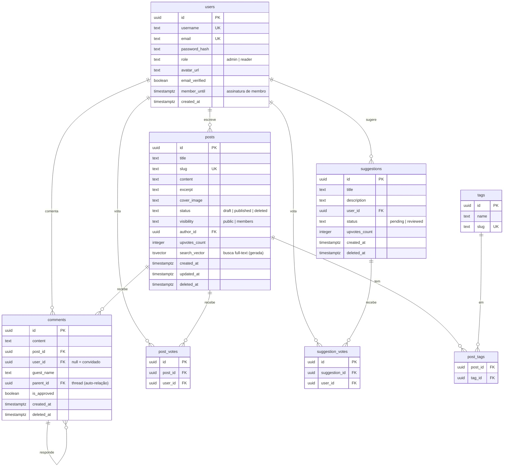

<div align="center">

# 🐀 RatHole — Backend

**API REST do blog RatHole** — Fastify + Drizzle ORM + PostgreSQL, toda em TypeScript.

Autenticação JWT com verificação de e-mail e reset de senha, posts com busca full-text, comentários em thread, sistema de sugestões com votos, área de membros e upload de imagens.

[](https://nodejs.org)
[](https://fastify.dev)
[](https://www.typescriptlang.org)
[](https://www.postgresql.org)
[](https://orm.drizzle.team)
[](https://render.com)

🔗 **Frontend:** [rathole-front](https://github.com/arthurcorona/rathole-front) · **Site:** [rathole.com.br](https://rathole.com.br)

</div>

---

## Sobre

Backend do **RatHole**, um blog full-stack de cibersegurança e tecnologia. Expõe uma API REST consumida pelo frontend em React ([rathole-front](https://github.com/arthurcorona/rathole-front)).

Nasceu **self-hosted** num homelab (Raspberry Pi com Docker, Nginx e Cloudflare Tunnel) e, por decisão de arquitetura, foi migrado para **infraestrutura em nuvem gerenciada** — eliminando a exposição pública do homelab e ganhando deploy contínuo. Veja [Arquitetura](#-arquitetura).

## ✨ Features

- 🔑 **Auth JWT** com papéis (`admin` / `reader`), hash de senha (bcrypt) e **rate limiting**
- 📧 **Verificação de e-mail** e **reset de senha** por link (via Resend)
- 📝 **Posts** em Markdown com **soft-delete** e tags (N:N)
- 🔎 **Busca full-text** em português (`tsvector` + `ts_rank`, com índice GIN)
- 💬 **Comentários em thread** (auto-relação), de usuários logados ou convidados
- 💡 **Sugestões** da comunidade com **votação** (voto único por usuário)
- ⬆️ **Upvotes** em posts
- 🔒 **Membership** — posts exclusivos (`visibility`) e guard `requireMember`
- 🖼️ **Upload de imagens** para **Supabase Storage**
- ✅ **Validação de entrada** com Zod em todas as rotas
- 📡 **Radar** — notícias de segurança enviadas por um coletor externo (token de serviço), curadas pelo admin: edição diária para membros e **Dossiê semanal** público

## 🧰 Stack

| Camada | Tecnologia |
|---|---|
| Runtime | **Node.js** + **TypeScript** (`tsx`) |
| Framework | **Fastify 5** (+ `cors`, `jwt`, `multipart`, `rate-limit`) |
| ORM / DB | **Drizzle ORM** + `postgres.js` → **PostgreSQL** (Supabase) |
| Auth | **@fastify/jwt** + **bcryptjs** |
| Validação | **Zod** |
| E-mail | **Resend** |
| Storage | **Supabase Storage** (`@supabase/supabase-js`) |
| Deploy | **Docker** → **Render** |

## 🗄️ Modelo de dados



> `post_tags` é a tabela pivô (N:N posts↔tags). `post_votes` e `suggestion_votes` têm **unique (item, user)** pra garantir voto único. `comments.parent_id` aponta pra própria tabela (threads).

## 🔌 Principais endpoints

| Método | Rota | Acesso | Descrição |
|---|---|---|---|
| `POST` | `/auth/signup` · `/login` | público | Cadastro / login (JWT) |
| `POST` | `/auth/verify-email` · `/resend-verification` | público | Verificação de e-mail |
| `POST` | `/auth/forgot-password` · `/reset-password` | público | Reset de senha por link |
| `PUT` | `/auth/profile` | logado | Editar perfil |
| `GET` | `/posts` `?q=` | público | Lista posts (busca + filtro de visibilidade) |
| `GET` | `/posts/:slug` | público | Detalhe do post |
| `POST`·`PUT`·`DELETE` | `/posts` · `/posts/:id` | admin | CRUD de post (delete = soft) |
| `POST`·`DELETE` | `/posts/:id/vote` | logado | Upvote / remover |
| `GET`·`POST` | `/posts/:postId/comments` · `/comments` | público* | Comentários (thread) |
| `DELETE` | `/comments/:id` | dono/admin | Apagar comentário (soft) |
| `GET`·`POST` | `/suggestions` | público / logado | Sugestões |
| `POST`·`DELETE` | `/suggestions/:id/vote` | logado | Votar / desfazer |
| `DELETE` | `/suggestions/:id` | dono/admin | Apagar sugestão (soft) |
| `GET`·`PUT` | `/users` · `/users/:id/membership` | admin | Listar usuários / conceder membership |
| `POST` | `/upload` | logado | Upload de imagem (Supabase Storage) |
| `POST` | `/radar/items` | header `x-radar-token` | Ingestão de notícias pelo coletor (dedup por `link`) |
| `GET`·`PATCH` | `/radar/admin` `?status=` · `/radar/admin/:id` | admin | Fila de curadoria / aprovar, descartar, tier, posição |
| `GET` | `/radar/daily` `?date=` `?days=` | membro | Edição do dia (itens `members` aprovados) |
| `GET` | `/radar/weekly` | público | Dossiê semanal (itens `public` aprovados, por posição) |
| `GET` | `/health` | público | Health check |

## 📁 Estrutura

```
src/
├─ core/
│  ├─ setup.ts        # plugins (cors, jwt, rate-limit, multipart)
│  ├─ decorators.ts   # guards: authenticate, requireAdmin, requireMember
│  ├─ validation.ts   # schemas Zod + helper validate()
│  └─ mailer.ts       # e-mails via Resend
├─ db/
│  ├─ schema.ts       # tabelas + relations (Drizzle)
│  └─ index.ts        # conexão (postgres.js + TLS)
├─ modules/
│  ├─ auth/           # login, signup, verificação, reset, profile
│  ├─ posts/          # CRUD, busca, votos, visibilidade
│  ├─ comments/       # threads, soft-delete
│  ├─ suggestions/    # sugestões + votos
│  ├─ uploads/        # upload → Supabase Storage
│  ├─ users/          # admin: listar / membership
│  └─ radar/          # ingestão (token), curadoria, edição diária, dossiê semanal
└─ utils/             # helpers (slugify, etc.)
drizzle/  # migrações SQL manuais (aplicar com npm run db:sql)
scripts/  # run-sql.ts
app.ts   # monta o Fastify e registra as rotas
server.ts # entrypoint
```

## 🚀 Rodando localmente

**Pré-requisitos:** Node.js 18+ e um PostgreSQL (recomendado: um projeto no [Supabase](https://supabase.com)).

```bash
git clone https://github.com/arthurcorona/rathole-back.git
cd rathole-back
npm install

cp .env.example .env         # preencha as variáveis (veja abaixo)
npx drizzle-kit push         # cria as tabelas no banco a partir do schema

npm run dev                  # http://localhost:3333
```

> A busca full-text usa uma coluna `search_vector` (tsvector gerada) + índice GIN, aplicada por migração SQL manual — veja `MIGRATION.md`.
> Como `search_vector` não está no `schema.ts`, **evite `drizzle-kit push` em banco existente** (ele tentaria remover a coluna). Novas tabelas entram por SQL em `drizzle/` via `npm run db:sql`.

## 🔐 Variáveis de ambiente

| Variável | Descrição |
|---|---|
| `DB_HOST` `DB_PORT` `DB_USER` `DB_PASS` `DB_NAME` | Conexão PostgreSQL (Supabase **session pooler**, porta 5432) |
| `JWT_SECRET` | Segredo dos tokens JWT |
| `SUPABASE_URL` | URL do projeto Supabase |
| `SUPABASE_SERVICE_KEY` | Chave **secreta** (service role) — nunca no frontend |
| `SUPABASE_BUCKET` | Bucket de uploads (ex: `uploads`) |
| `RESEND_API_KEY` `EMAIL_FROM` | Envio de e-mail (Resend) |
| `APP_URL` | URL do frontend (usada nos links de e-mail) |
| `PORT` | Porta do servidor (default 3333) |
| `RADAR_TOKEN` | Token de serviço do coletor **radar** (header `x-radar-token`). Gere com `openssl rand -hex 32` |

## 📜 Scripts

| Comando | O que faz |
|---|---|
| `npm run dev` | Servidor com hot-reload (`tsx watch`) |
| `npm run build` | Compila TypeScript |
| `npm start` | Roda o build |
| `npx drizzle-kit push` | Sincroniza o schema com o banco |
| `npm run db:sql -- drizzle/<arquivo>.sql` | Aplica uma migração SQL manual (ex.: `radar_items`) |

## 🏗️ Arquitetura

```
Browser → rathole.com.br            (Frontend — React, Vercel)
        → rathole-back.onrender.com  (esta API — Fastify, Render/Docker)
                                     ├── PostgreSQL → Supabase
                                     └── Uploads    → Supabase Storage
                                     └── E-mail     → Resend
```

O backend é **stateless** (uploads vão pro object storage, não pro disco), o que permite rodar em plataformas efêmeras como o Render. A migração completa (homelab → nuvem) está documentada em `MIGRATION.md`.

## 🔗 Projeto relacionado

- **[rathole-front](https://github.com/arthurcorona/rathole-front)** — frontend em React + Vite + Tailwind (estética de terminal).

---

<div align="center">
Feito por <a href="https://github.com/arthurcorona">Arthur Corona</a>
</div>
